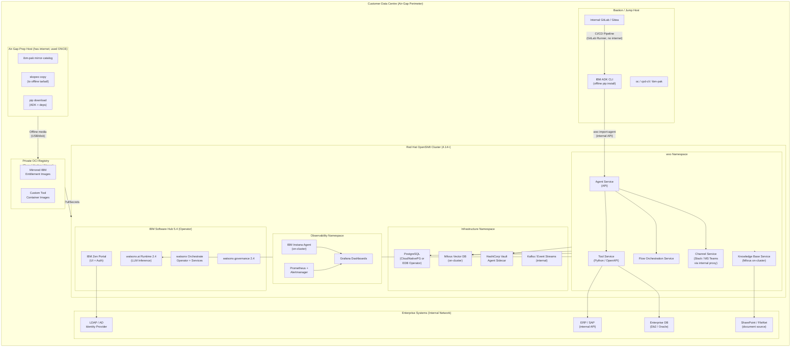

# watsonx Orchestrate — Air-Gap (Disconnected) Deployment Design

> **Design artifact** — route for review and approval before implementation.
> Store implementation artifacts in `bob-watsonx-orchestrate-store/airgap-wxo/`.
> Version: 1.0.0 | Date: 2026-10-20 | Status: DRAFT

---

## 1. Executive Summary

This design specifies a production-grade, fully disconnected (air-gap) deployment of
**IBM watsonx Orchestrate** in a customer-controlled data centre. No runtime traffic
exits the security perimeter; all container images, model weights, Python packages, and
ADK artifacts are mirrored inside before installation. The solution runs on
**Red Hat OpenShift Container Platform (OCP) 4.14+** managed by
**IBM Software Hub 5.4** and integrates optional local foundation-model inference via
**IBM watsonx.ai Runtime** (also on Software Hub 5.4).

Key outcomes:
- Zero internet dependency at runtime.
- Customer owns all data, credentials, and model artefacts.
- Agents, tools, and knowledge bases authored with the IBM ADK and promoted through
  dev → staging → production gates entirely within the perimeter.
- Governance enforced via **watsonx.governance 2.4 on Software Hub 5.4**.

---

## 2. Deployment Target Classification

| Dimension | Value |
|---|---|
| Deployment model | **Software on IBM Software Hub 5.4** (on-premises) |
| Network posture | **Air-gap / disconnected** — no egress to public internet |
| Container platform | Red Hat OpenShift Container Platform 4.14+ |
| Compute location | Customer data centre (bare metal or VMware) |
| Image registry | Customer-managed private OCI registry (e.g. Quay Enterprise, Harbor, Nexus) |
| Model inference | IBM watsonx.ai Runtime 2.4 on-cluster (Software Hub 5.4) |
| Identity provider | Customer LDAP / Active Directory via IBM Security Verify Directory or OIDC |
| Secret management | HashiCorp Vault (on-premises) or OpenShift Secrets with RBAC |
| Observability | IBM Instana on-premises or OpenShift built-in monitoring (Prometheus / Alertmanager) |
| Governance | watsonx.governance 2.4 on Software Hub 5.4 |

> **Key distinction from SaaS:** You provision and maintain hardware, install and
> upgrade software, provide persistent storage on OCP, and buy per-service software
> licenses. IBM Software Hub 5.4 is the on-premises operator-based installer.
> `Monitor watsonx Orchestrate agents` feature is available only on IBM Cloud SaaS (not
> Software Hub); compensate with Instana + custom Prometheus metrics.

---

## 3. Architecture Diagram



---

## 4. Infrastructure Requirements

### 4.1 Compute (Minimum Production)

| Node Role | Count | vCPU | RAM | Storage |
|---|---|---|---|---|
| OCP Control Plane | 3 | 16 | 64 GB | 500 GB SSD |
| OCP Worker — WXO/Hub | 3 | 32 | 128 GB | 1 TB NVMe |
| OCP Worker — LLM Inference | 2–4 | 32 + GPU | 256 GB | 2 TB NVMe |
| OCP Worker — Observability | 2 | 16 | 64 GB | 500 GB SSD |
| Bastion / Jump | 1 | 8 | 32 GB | 500 GB |
| Private Registry Host | 1–2 | 16 | 64 GB | 4 TB SSD |

> GPU workers required only if serving foundation models locally (watsonx.ai Runtime).
> Refer to IBM Software Hub 5.4 hardware requirements:
> `https://www.ibm.com/docs/SSNFH6_5.4.x/sys-reqs/hardware-reqs.html`

### 4.2 Storage (Persistent)

| Component | Type | Minimum Size |
|---|---|---|
| PostgreSQL (WXO metadata) | RWO Block | 500 GB |
| Milvus (vector store) | RWO Block | 1 TB |
| Model weights (watsonx.ai Runtime) | RWX File | 2–10 TB |
| Kafka logs | RWO Block | 200 GB |
| Prometheus TSDB | RWO Block | 200 GB |
| Registry (Quay/Harbor) | RWO Block | 4 TB |

### 4.3 Network

- All nodes resolvable via internal DNS (no public DNS required).
- Wildcard TLS certificate for `*.apps.<cluster-domain>` (internal CA acceptable).
- Internal load balancer for OCP ingress (HAProxy or F5).
- No default route to public internet required at runtime.
- Internal NTP source.

---

## 5. Air-Gap Preparation (One-Time, on Internet-Connected Host)

Perform these steps **before** media transfer. The prep host must have internet access;
it is **not** the target cluster.

### 5.1 Mirror IBM Operator Catalogs

```bash
# Install ibm-pak plugin
oc ibm-pak config repo 'IBM operator catalog' \
  --url https://github.com/IBM/cloud-pak/raw/main/repo/case

# Download CASE for watsonx Orchestrate
oc ibm-pak get ibm-watsonx-orchestrate --version <TARGET_VERSION>

# Mirror to local directory (tarball or direct to private registry)
oc ibm-pak launch ibm-watsonx-orchestrate \
  --version <TARGET_VERSION> \
  --inventory ibmWatsonxOrchestrate \
  --action mirror-images \
  --args "--registry <PRIVATE_REGISTRY_HOST>/ibm --inputdir ~/.ibm-pak/data/cases"

# Repeat for Software Hub, watsonx.ai Runtime, watsonx.governance
oc ibm-pak get ibm-cpd-platform --version <TARGET_VERSION>
oc ibm-pak get ibm-watsonx-ai     --version <TARGET_VERSION>
oc ibm-pak get ibm-watsonx-governance --version <TARGET_VERSION>
```

### 5.2 Mirror Foundation Model Weights (watsonx.ai Runtime)

```bash
# Download approved model(s) — e.g. granite-13b-instruct
ibm-watsonx-ai model download \
  --model-id ibm/granite-13b-instruct-v2 \
  --output-dir /mnt/offline-media/models/
```

### 5.3 Mirror Python Packages (ADK + Tools)

```bash
# On internet-connected machine
pip download ibm-watsonx-orchestrate-agent-toolkit \
  --dest /mnt/offline-media/pypi/ \
  --no-deps

# Collect all transitive deps
pip download ibm-watsonx-orchestrate-agent-toolkit \
  --dest /mnt/offline-media/pypi/
```

### 5.4 Media Transfer

Transfer `/mnt/offline-media/` to the air-gap environment via:
- Encrypted USB drive (FIPS 140-2 compliant).
- Secure file transfer to internal media host.
- Data diode (one-way transfer appliance) for classified environments.

---

## 6. Installation Sequence (Inside Air-Gap)

```
Step 1: Bootstrap OCP cluster (UPI or IPI with local mirror)
Step 2: Configure ImageContentSourcePolicy → private registry
Step 3: Install IBM Software Hub 5.4 operator (cpd-cli manage)
Step 4: Install watsonx Orchestrate service
Step 5: Install watsonx.ai Runtime service (if local LLM)
Step 6: Install watsonx.governance service
Step 7: Configure LDAP/OIDC identity provider
Step 8: Load model weights (PVC mount or object store)
Step 9: Configure Vault sidecar for secrets injection
Step 10: Deploy Instana agent + Prometheus exporters
Step 11: ADK offline environment setup (local pip mirror)
Step 12: Import initial agents, tools, knowledge bases via ADK
```

### 6.1 ImageContentSourcePolicy (OCP Mirror Config)

```yaml
# ocp-imagecontentsourcepolicy.yaml
apiVersion: operator.openshift.io/v1alpha1
kind: ImageContentSourcePolicy
metadata:
  name: ibm-wxo-airgap
spec:
  repositoryDigestMirrors:
    - source: icr.io/cpopen
      mirrors:
        - <PRIVATE_REGISTRY_HOST>/cpopen
    - source: cp.icr.io/cp
      mirrors:
        - <PRIVATE_REGISTRY_HOST>/cp
    - source: icr.io/ibm-watsonx-orchestrate
      mirrors:
        - <PRIVATE_REGISTRY_HOST>/ibm-watsonx-orchestrate
```

### 6.2 ADK Offline Install

```bash
# On bastion (no internet)
python -m pip install \
  --no-index \
  --find-links /mnt/offline-media/pypi/ \
  ibm-watsonx-orchestrate-agent-toolkit

# Verify
wxo-env check
```

---

## 7. Agent Architecture

### 7.1 Agent Topology

```
┌─────────────────────────────────────────────────────────┐
│                  Supervisor Agent (Router)               │
│  Model: granite-13b-instruct (local watsonx.ai Runtime) │
│  Purpose: Intent classification + task delegation        │
└───────────────────┬────────────────────┬────────────────┘
                    │                    │
        ┌───────────▼──────┐   ┌────────▼──────────┐
        │  Domain Agent A  │   │  Domain Agent B    │
        │  (HR / Finance)  │   │  (Operations/ERP)  │
        └──────────┬───────┘   └──────────┬─────────┘
                   │                      │
         ┌─────────▼────┐       ┌─────────▼────┐
         │  Tool Layer  │       │  Tool Layer  │
         │ (Python/OAS) │       │ (Python/OAS) │
         └─────────┬────┘       └──────────────┘
                   │
         ┌─────────▼──────┐
         │  Knowledge Base │
         │ (Milvus on-OCP) │
         └─────────────────┘
```

### 7.2 Agent Specifications

#### Supervisor Agent

```yaml
# agents/supervisor/agent.yaml
agent:
  name: wxo-airgap-supervisor
  type: native
  purpose: >
    Route user requests to the correct domain agent. Handles intent
    classification without calling external LLM APIs.
  model:
    provider: watsonx            # local watsonx.ai Runtime endpoint
    model_id: ibm/granite-13b-instruct-v2
    api_url: https://watsonx-ai.apps.<CLUSTER_DOMAIN>/ml/v1
    api_key_secret: wxo-model-apikey   # from Vault sidecar
    parameters:
      max_new_tokens: 512
      temperature: 0.1
  instructions: |
    You are the routing supervisor for internal enterprise agents deployed
    in a disconnected environment. Classify the user intent and delegate
    to the most appropriate domain agent. Never call external internet APIs.
    Respond in the same language as the user.
  collaborators:
    - wxo-airgap-hr-agent
    - wxo-airgap-ops-agent
  channels:
    - ms_teams_internal          # internal MS Teams (on-premises)
    - web_chat_internal          # embedded web chat (internal portal)
  human_approval_required: false
  risk_tier: medium
```

#### Domain Agent — HR / Finance

```yaml
# agents/hr-agent/agent.yaml
agent:
  name: wxo-airgap-hr-agent
  type: native
  purpose: >
    Handle employee HR and finance queries: leave balances, payroll,
    policy lookups, expense approvals.
  model:
    provider: watsonx
    model_id: ibm/granite-13b-instruct-v2
    api_url: https://watsonx-ai.apps.<CLUSTER_DOMAIN>/ml/v1
    api_key_secret: wxo-model-apikey
  instructions: |
    You are an HR and Finance assistant. Only answer questions about
    HR policies, leave, payroll, and expenses using the internal
    knowledge base and approved internal APIs. Do not access external
    services or the internet.
  tools:
    - leave_balance_tool
    - policy_search_tool
    - expense_approval_tool
  knowledge_bases:
    - hr_policy_kb
  human_approval_required: true     # for expense approval actions
  human_approval_threshold: high_risk_actions
  risk_tier: high
```

#### Domain Agent — Operations / ERP

```yaml
# agents/ops-agent/agent.yaml
agent:
  name: wxo-airgap-ops-agent
  type: native
  purpose: >
    Handle operational queries against internal ERP and Db2 systems:
    inventory, order status, supplier data.
  model:
    provider: watsonx
    model_id: ibm/granite-13b-instruct-v2
    api_url: https://watsonx-ai.apps.<CLUSTER_DOMAIN>/ml/v1
    api_key_secret: wxo-model-apikey
  tools:
    - erp_inventory_tool
    - order_status_tool
    - db2_query_tool
  human_approval_required: true
  human_approval_threshold: write_operations
  risk_tier: high
```

---

## 8. Tool Specifications

### 8.1 Tool: `leave_balance_tool`

```python
# tools/leave_balance_tool/tool.py
from ibm_watsonx_orchestrate.agent_builder.tools import tool, ToolPermission

@tool(
    name="leave_balance_tool",
    description="Retrieve remaining leave balance for a given employee ID from the internal HR system.",
    permission=ToolPermission.READ
)
def get_leave_balance(employee_id: str) -> dict:
    """
    Args:
        employee_id: The internal employee identifier.
    Returns:
        dict with annual_leave, sick_leave, and carry_over fields.
    """
    # Calls internal HR REST API — no internet dependency
    import os, requests
    hr_api_url = os.environ["HR_API_URL"]          # injected by Vault sidecar
    hr_api_key = os.environ["HR_API_KEY"]          # injected by Vault sidecar
    resp = requests.get(
        f"{hr_api_url}/employees/{employee_id}/leave-balance",
        headers={"X-API-Key": hr_api_key},
        verify="/etc/ssl/certs/internal-ca.crt",   # internal CA bundle
        timeout=10
    )
    resp.raise_for_status()
    return resp.json()
```

### 8.2 Tool: `policy_search_tool`

```python
# tools/policy_search_tool/tool.py
from ibm_watsonx_orchestrate.agent_builder.tools import tool, ToolPermission

@tool(
    name="policy_search_tool",
    description="Search the internal HR policy knowledge base using a natural language query.",
    permission=ToolPermission.READ
)
def search_policy(query: str, top_k: int = 5) -> list[dict]:
    """
    Args:
        query: Natural language search query.
        top_k: Number of results to return (default 5).
    Returns:
        list of policy document snippets with title, section, and text.
    """
    # Hits local Milvus-backed knowledge base via WXO KB API
    import os, requests
    kb_url = os.environ["WXO_KB_API_URL"]
    kb_token = os.environ["WXO_KB_TOKEN"]
    resp = requests.post(
        f"{kb_url}/knowledge-bases/hr_policy_kb/search",
        json={"query": query, "top_k": top_k},
        headers={"Authorization": f"Bearer {kb_token}"},
        verify="/etc/ssl/certs/internal-ca.crt",
        timeout=15
    )
    resp.raise_for_status()
    return resp.json().get("results", [])
```

### 8.3 Tool: `db2_query_tool` (Read-Only)

```python
# tools/db2_query_tool/tool.py
from ibm_watsonx_orchestrate.agent_builder.tools import tool, ToolPermission

@tool(
    name="db2_query_tool",
    description="Execute a read-only parameterised query against the internal Db2 operational database.",
    permission=ToolPermission.READ
)
def query_db2(query_name: str, params: dict) -> list[dict]:
    """
    Args:
        query_name: Named query key from the approved query catalog.
        params: Dict of bind parameters for the named query.
    Returns:
        list of row dicts.
    """
    import os, ibm_db, json
    ALLOWED_QUERIES = {
        "order_status":  "SELECT * FROM ORDERS WHERE ORDER_ID = ?",
        "inventory_qty": "SELECT * FROM INVENTORY WHERE SKU = ?"
    }
    if query_name not in ALLOWED_QUERIES:
        raise ValueError(f"Query '{query_name}' is not in the approved catalog.")
    conn_str = os.environ["DB2_CONN_STRING"]   # from Vault
    conn = ibm_db.connect(conn_str, "", "")
    stmt = ibm_db.prepare(conn, ALLOWED_QUERIES[query_name])
    for i, v in enumerate(params.values(), start=1):
        ibm_db.bind_param(stmt, i, v)
    ibm_db.execute(stmt)
    rows = []
    row = ibm_db.fetch_assoc(stmt)
    while row:
        rows.append(row)
        row = ibm_db.fetch_assoc(stmt)
    return rows
```

---

## 9. Knowledge Base Design

### 9.1 `hr_policy_kb`

| Property | Value |
|---|---|
| Name | `hr_policy_kb` |
| Backend | Milvus on-cluster (wxo namespace) |
| Embedding model | `ibm/slate-30m-english-rtrvr` (on-cluster via watsonx.ai Runtime) |
| Chunk size | 512 tokens, 64 overlap |
| Document sources | SharePoint (crawled via internal connector), PDF uploads |
| Refresh schedule | Nightly at 02:00 internal time |
| Access control | HR role group (LDAP) |

```yaml
# knowledge-bases/hr_policy_kb.yaml
knowledge_base:
  name: hr_policy_kb
  description: Internal HR policies, procedures, and employee handbook.
  vector_store:
    type: milvus
    endpoint: milvus.wxo.svc.cluster.local:19530   # in-cluster
    collection: hr_policy_chunks
  embedding:
    provider: watsonx
    model_id: ibm/slate-30m-english-rtrvr
    api_url: https://watsonx-ai.apps.<CLUSTER_DOMAIN>/ml/v1
    api_key_secret: wxo-model-apikey
  chunking:
    strategy: recursive_character
    chunk_size: 512
    chunk_overlap: 64
  ingestion:
    sources:
      - type: sharepoint_internal
        connector: sharepoint-internal-connector
        library: HR Policies
      - type: local_pdf
        path: /mnt/hr-docs/
    schedule: "0 2 * * *"    # cron, daily 02:00
```

---

## 10. Connections & Secrets

### 10.1 Secret Injection Strategy (Vault Agent Sidecar)

All runtime secrets are injected by the HashiCorp Vault Agent sidecar into the pod
environment — never hardcoded or stored in ConfigMaps.

```yaml
# Example pod annotation for Vault injection
vault.hashicorp.com/agent-inject: "true"
vault.hashicorp.com/role: "wxo-tool-role"
vault.hashicorp.com/agent-inject-secret-hr-api-key: "secret/wxo/hr-api-key"
vault.hashicorp.com/agent-inject-template-hr-api-key: |
  {{- with secret "secret/wxo/hr-api-key" -}}
  export HR_API_KEY="{{ .Data.data.value }}"
  {{- end }}
```

### 10.2 Connection Registry

| Connection ID | Target System | Auth Type | Secret Path (Vault) |
|---|---|---|---|
| `hr-api-connection` | Internal HR REST API | API Key | `secret/wxo/hr-api-key` |
| `erp-connection` | SAP / internal ERP | Basic Auth | `secret/wxo/erp-creds` |
| `db2-connection` | Db2 operational DB | JDBC DSN | `secret/wxo/db2-conn-string` |
| `milvus-connection` | Milvus (in-cluster) | mTLS | `secret/wxo/milvus-tls` |
| `model-api-connection` | watsonx.ai Runtime (in-cluster) | API Key | `secret/wxo/model-apikey` |
| `sharepoint-connection` | Internal SharePoint | OAuth2 (internal IdP) | `secret/wxo/sharepoint-oauth` |

---

## 11. Identity & Access

| Role | Mapped to | Permissions |
|---|---|---|
| `wxo-admin` | LDAP group: `cn=wxo-admins` | Manage agents, tools, KB; configure platform |
| `wxo-agent-builder` | LDAP group: `cn=wxo-builders` | Create/edit agents and tools; deploy to dev |
| `wxo-user` | LDAP group: `cn=wxo-users` | Use chat UI; query agents |
| `wxo-approver` | LDAP group: `cn=wxo-approvers` | Approve human-in-the-loop actions |
| `wxo-auditor` | LDAP group: `cn=wxo-auditors` | Read-only access to logs, traces, governance |

LDAP/OIDC federation is configured through IBM Zen Portal (Software Hub IdP connector).
MFA is enforced for `wxo-admin` and `wxo-approver` roles.

---

## 12. Channels

| Channel | Mechanism | Notes |
|---|---|---|
| MS Teams (internal) | On-premises MS Teams Server or MS Teams hybrid via internal proxy | No public MS Teams cloud dependency |
| Web Chat | Embedded iframe in internal intranet portal | Served from OCP Route (internal DNS only) |
| Slack (optional) | Slack on-premises (Enterprise Grid with internal data residency) | Only if customer runs Slack on-prem |

---

## 13. ADK Build & Promotion Pipeline

### 13.1 Pipeline Overview (Internal GitLab CI)

```yaml
# .gitlab-ci.yml (internal GitLab, no internet)
stages:
  - validate
  - build
  - test
  - promote-dev
  - promote-staging
  - promote-prod   # manual gate

variables:
  WXO_ENV_DEV:     https://wxo-dev.apps.<CLUSTER_DOMAIN>
  WXO_ENV_STAGING: https://wxo-staging.apps.<CLUSTER_DOMAIN>
  WXO_ENV_PROD:    https://wxo-prod.apps.<CLUSTER_DOMAIN>

validate:
  script:
    - source /opt/wxo-venv/bin/activate
    - wxo-env check
    - wxo agent validate --all

build:
  script:
    - wxo agent build --output dist/

test:
  script:
    - wxo agent test --suite tests/

promote-dev:
  script:
    - wxo agent import --file dist/ --env $WXO_ENV_DEV

promote-staging:
  script:
    - wxo agent import --file dist/ --env $WXO_ENV_STAGING
  when: manual

promote-prod:
  script:
    - wxo agent import --file dist/ --env $WXO_ENV_PROD
  when: manual
  rules:
    - if: '$CI_COMMIT_BRANCH == "main"'
```

### 13.2 Promotion Environments

| Environment | Namespace | Purpose | Approval Gate |
|---|---|---|---|
| `dev` | `wxo-dev` | Developer iteration | Automated CI |
| `staging` | `wxo-staging` | UAT + security review | Manual: Agent Builder |
| `production` | `wxo-prod` | Live users | Manual: Platform Owner + CISO |

---

## 14. Observability

### 14.1 Metrics (Prometheus)

| Metric | Source | Alert Threshold |
|---|---|---|
| `wxo_agent_request_total` | WXO metrics endpoint | — |
| `wxo_agent_latency_p99` | WXO metrics endpoint | > 5s → Warning |
| `wxo_tool_error_rate` | WXO tool service | > 5% → Critical |
| `wxo_kb_query_latency_p99` | Milvus exporter | > 2s → Warning |
| `ocp_node_cpu_utilization` | Prometheus node-exporter | > 85% → Warning |

### 14.2 Logging

- All WXO pods stream structured JSON to OpenShift Logging (Elasticsearch or Loki stack).
- Prompt and tool invocation traces retained for 90 days (configurable).
- Log access restricted to `wxo-auditor` role.

### 14.3 Instana (on-cluster agent)

- Instana agent deployed as DaemonSet on all worker nodes.
- Traces all Python tool invocations and LLM inference calls end-to-end.
- No Instana SaaS backend — data stays on-cluster (Instana on-premises backend required).

---

## 15. Governance

> `Monitor watsonx Orchestrate agents` is a SaaS-only feature (IBM Cloud / AWS).
> On Software Hub, governance is via watsonx.governance 2.4 Evaluation Studio +
> Guardrails Manager locally, plus custom Prometheus metrics exported to Grafana.

| Control | Mechanism |
|---|---|
| Model risk register | watsonx.governance 2.4 AI Factsheet (on-premises) |
| Prompt injection defense | Input/output guardrails via Guardrails Manager (Software Hub) |
| PII detection | Custom guardrail rule (regex + NER model on-cluster) |
| Human approval (high-risk) | WXO human-in-the-loop approval gate (internal notify via MS Teams) |
| Audit trail | OpenShift audit logs + WXO trace retention |
| Data classification | All data classified CONFIDENTIAL; no data leaves perimeter |
| Model approval gate | watsonx.governance AI Lifecycle — staging approval required |
| Vulnerability scanning | Red Hat Advanced Cluster Security (RHACS) — image scan pre-deploy |
| Secret rotation | Vault dynamic secrets with 24-hour TTL |

---

## 16. Rollback Procedure

```bash
# 1. Export current production state before promotion
wxo agent export --env $WXO_ENV_PROD --output backups/prod-$(date +%Y%m%d).zip

# 2. On incident: roll back to previous version
wxo agent import --file backups/prod-<PREVIOUS_DATE>.zip --env $WXO_ENV_PROD

# 3. If OCP operator upgrade caused regression: rollback operator
oc rollout undo deployment/watsonx-orchestrate-operator -n ibm-common-services
```

---

## 17. Feature Gap Register (SaaS → Software Hub)

| SaaS Feature | Available on Software Hub 5.4 | Mitigation |
|---|---|---|
| Monitor WXO agents in watsonx.governance | ❌ IBM Cloud only | Custom Prometheus metrics + Grafana |
| Govern Discovered Shadow AI Agents | ❌ AWS SaaS only | Manual AI Factsheet registration |
| Deploy on-demand foundation models | ❌ Not available | Pre-deploy models via watsonx.ai Runtime |
| Automatic software updates | ❌ Manual | cpd-cli upgrade procedure + change mgmt |
| IBM Cloud IAM integration | ❌ Not applicable | LDAP/OIDC via Zen Portal |

---

## 18. Test Cases

| ID | Test | Expected Result | Priority |
|---|---|---|---|
| T-001 | Supervisor routes "leave balance" intent to HR agent | HR agent invoked | P0 |
| T-002 | HR agent calls `leave_balance_tool` with valid employee ID | Returns balance dict | P0 |
| T-003 | HR agent calls `policy_search_tool` with policy query | Returns ≥ 1 result | P0 |
| T-004 | Ops agent refuses query outside approved query catalog | `ValueError` raised | P0 |
| T-005 | Human approval gate triggers for expense approval | Approval request sent to approver | P1 |
| T-006 | Agent invocation with no network egress | Completes without 503/timeout to internet | P0 |
| T-007 | Vault-injected secret rotates; tool continues working | Tool re-reads env without restart | P1 |
| T-008 | LLM inference served by local watsonx.ai Runtime | Latency < 5s P99 | P0 |
| T-009 | Knowledge base nightly refresh succeeds | Milvus collection updated | P1 |
| T-010 | Promotion to prod requires manual approval in GitLab | Pipeline blocked until approval | P0 |

---

## 19. Owners & Approvals

| Role | Name (Placeholder) | Responsibility |
|---|---|---|
| Platform Owner | `<CUSTOMER_PLATFORM_OWNER>` | OCP + Software Hub operations |
| Agent Builder Lead | `<CUSTOMER_AGENT_LEAD>` | Agent design, ADK, CI/CD |
| CISO / Security | `<CUSTOMER_CISO>` | Air-gap controls, Vault, RBAC |
| Data Owner | `<CUSTOMER_DATA_OWNER>` | Knowledge base content, data classification |
| IBM Architect | IBM Bob WXA Appliance | Design + ADK guidance |

---

## 20. Next Steps

1. **Confirm** OCP cluster size and hardware procurement with customer infrastructure team.
2. **Obtain** IBM Software Hub 5.4 + watsonx Orchestrate entitlement keys (Passport Advantage).
3. **Run** air-gap preparation (`ibm-pak` mirror) on internet-connected staging host.
4. **Execute** Software Hub 5.4 installation using `cpd-cli manage` offline procedure.
5. **Implement** ADK tool stubs in `bob-watsonx-orchestrate-store/airgap-wxo/`.
6. **Configure** Vault, Prometheus, and Instana before first agent deployment.
7. **Conduct** security review with customer CISO before staging promotion.
8. **Schedule** production promotion with change management board.

---

*Design produced by IBM Bob WXA Appliance — wxo-agent-architect mode.*
*Route questions, change requests, and approval sign-offs to the owners listed in §19.*
