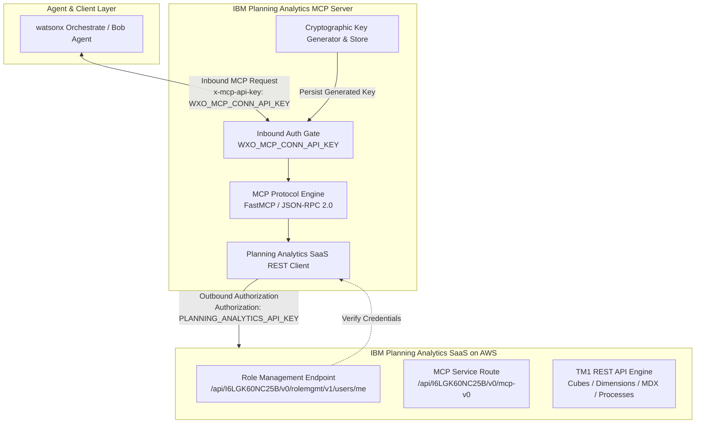

# IBM Planning Analytics SaaS MCP Server Architecture & Design

## 1. Overview & Objectives

This design defines the architecture and deployment model for a custom **Model Context Protocol (MCP)** Server bridging IBM watsonx Orchestrate (and Bob agents) to **IBM Planning Analytics SaaS running on AWS**.

The MCP server exposes governed Planning Analytics capabilities—such as multidimensional query execution, cube and dimension inspection, TurboIntegrator process triggers, and user role validation—as standardized tools compliant with JSON-RPC 2.0.

---

## 2. Target System & Topology



### Infrastructure Endpoints
- **Cloud Provider & Region**: AWS (`us-east-1`)
- **Tenant ID**: `I6LGK60NC25B`
- **Base Service URL**: `https://us-east-1.planninganalytics.saas.ibm.com/api/I6LGK60NC25B`
- **User Profile / Role Verification Endpoint**: `https://us-east-1.planninganalytics.saas.ibm.com/api/I6LGK60NC25B/v0/rolemgmt/v1/users/me`
- **MCP Server Route**: `https://us-east-1.planninganalytics.saas.ibm.com/api/I6LGK60NC25B/v0/mcp-v0`

---

## 3. Dual-Layer Authentication Architecture

```
+-----------------------------------------------------------------------------------------+
|                                     INBOUND LAYER                                       |
|  Agent / Client -----[ WXO_MCP_CONN_API_KEY ]-----> MCP Server                         |
|  * Generated automatically on initial setup using CSPRNG (secrets.token_urlsafe).      |
|  * Persisted into .env as `WXO_MCP_CONN_API_KEY` for client reuse.                    |
+-----------------------------------------------------------------------------------------+
                                           |
                                           v
+-----------------------------------------------------------------------------------------+
|                                     OUTBOUND LAYER                                      |
|  MCP Server -----[ PLANNING_ANALYTICS_API_KEY ]-----> IBM Planning Analytics SaaS (AWS) |
|  * Reads `PLANNING_ANALYTICS_API_KEY` from .env.                                        |
|  * Authenticates REST requests against /rolemgmt/v1/users/me and TM1 endpoints.         |
+-----------------------------------------------------------------------------------------+
```

---

## 4. MCP Tools Catalog

| Tool Name | Endpoint / Operation | Description |
| :--- | :--- | :--- |
| `pa_verify_connectivity` | `GET /v0/rolemgmt/v1/users/me` | Validates credentials and returns current user name, tenant ID, and role. |
| `pa_list_cubes` | `GET /api/v1/Cubes` | Lists all active cubes with dimensions and rule metadata. |
| `pa_list_dimensions` | `GET /api/v1/Dimensions` | Lists multidimensional structures and hierarchies. |
| `pa_execute_mdx` | `POST /api/v1/ExecuteMDX` | Executes multidimensional MDX queries and returns cellset data. |
| `pa_run_process` | `POST /api/v1/Processes('{name}')/Execute` | Triggers a TurboIntegrator (TI) process with parameters. |
| `pa_list_chores` | `GET /api/v1/Chores` | Inspects scheduled TM1 chore tasks and status. |

---

## 5. Security & Governance Controls

1. **Zero Exposure of Raw Secrets**: Outbound API key and generated MCP API key are masked in all logs and outputs.
2. **Standard Stdio Protection**: In stdio mode, all logging is strictly routed to `stderr` to prevent JSON-RPC transport corruption.
3. **Environment Isolation**: Configured via `.env` loaded from the project root.
4. **Key Rotation & Persistence**: Automatic creation of `WXO_MCP_CONN_API_KEY` when empty, preserving existing keys across restarts.
